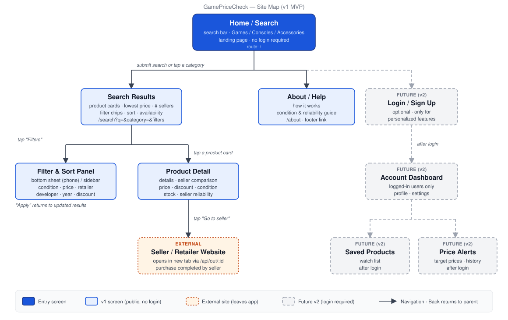
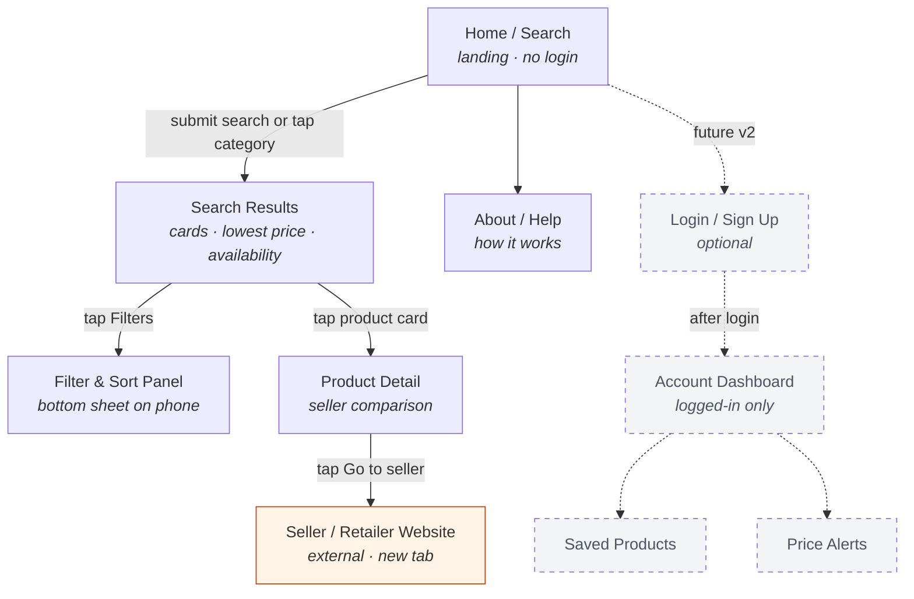

# GamePriceCheck — Site Map

Hierarchical map of every screen. Each arrow is a navigation path from parent to child; the browser/app **Back** action returns to the parent.

## Screens

| Screen | Route | Reached from | Notes |
| --- | --- | --- | --- |
| Home / Search | `/` | App launch | Search bar + Games / Consoles / Accessories shortcuts. No login. |
| Search Results | `/search?q=&category=&…` | Home (submit search or tap category) | Product cards with lowest price, seller count, condition, availability. Filters live in the URL. |
| Filter & Sort Panel | overlay on `/search` | Search Results ("Filters" button) | Bottom sheet on phones, sidebar on desktop. Condition, price, retailer, developer, year, discount, sort. "Apply" returns to updated results. |
| Product Detail | `/product/:id` | Search Results (tap card) | Details plus seller comparison: price, discount, condition, stock, seller reliability. |
| Seller / Retailer Website | external via `/api/out/:listingId` | Product Detail ("Go to seller") | Opens in a new tab. Purchase happens on the seller's site. |
| About / Help | `/about` | Home (footer link) | How it works; explains conditions and reliability ratings. |
| Login / Sign Up | `/login` | Home (header) | **Future v2.** Optional; only for personalized features. |
| Account Dashboard | `/account` | Login | **Future v2.** Logged-in users only. |
| Saved Products | `/account/saved` | Account Dashboard | **Future v2.** After login. |
| Price Alerts | `/account/alerts` | Account Dashboard | **Future v2.** After login. |

## Text version (Mermaid)

